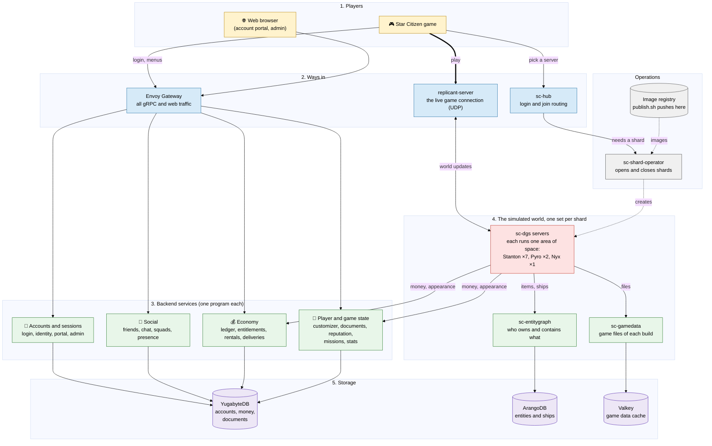

# Infrastructure

The deployment as it runs on the cluster (read from the cluster and from `README.md` and `DATA.md`, 2026-11-16).
Ownership of data and the gRPC calls between services are listed in [DATA.md](DATA.md).

## Reading it

- **Entry points**: the game reaches the gRPC services only through the Envoy Gateway `sc-edge`; `sc-hub` and the
  shard's `replicant-server` use NodePorts (the game's TCP and UDP traffic is not proxied).
- **Shards**: each shard is its own namespace holding one `replicant-server` (`sc-pu-frontend`) and one `sc-dgs` pod per
  area. Shard namespaces are made and removed by `sc-shard-operator`; a DGS has no database access and asks the owning
  services over gRPC.
- **Data**: relational data is in YugabyteDB (`scbackend-data`), entities in each region's ArangoDB, game data in each
  region's Valkey behind `sc-gamedata`. Only the owning service touches its tables or collections.
- **Deployment**: this repository only publishes to the registry; a separate deployment pulls from it. Arrows from the
  registry are the pulls.
- Edges are the main ones, not every call: [DATA.md](DATA.md) has the full table.
